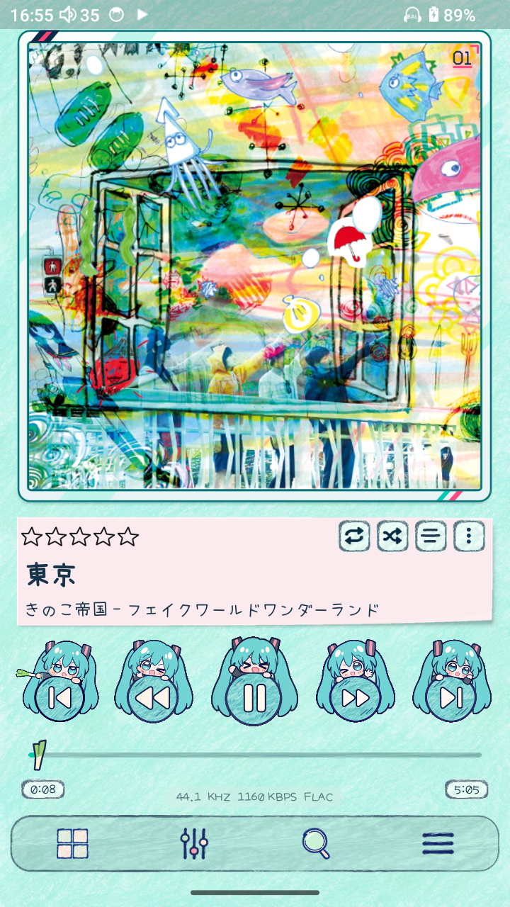
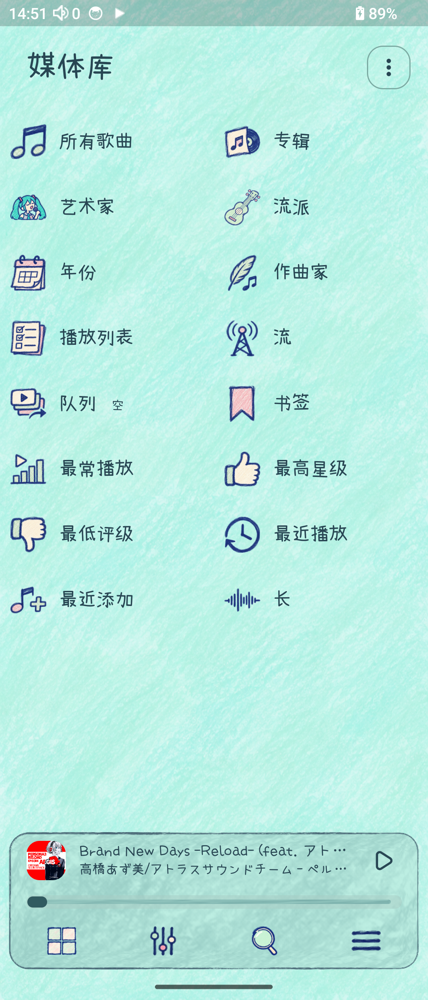
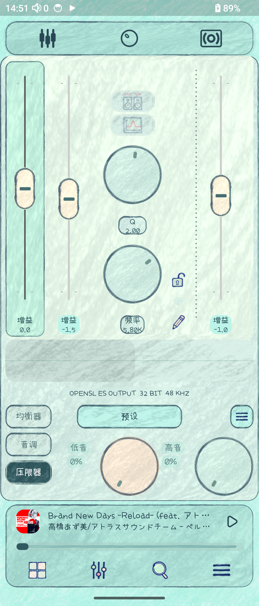
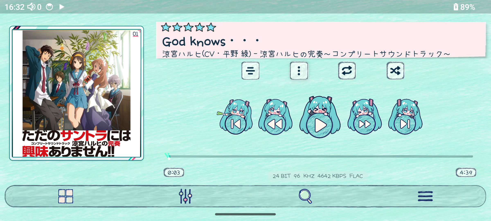

# Hand-drawn Miku

[简体中文](README.md) · [English](README.en.md) · [日本語](README.ja.md) · [한국어](README.ko.md)

A free, unofficial skin for Poweramp on Android. A mint-green hand-drawn interface frames the album cover. The song title sits on a paper label with a curled edge, above five playback buttons illustrated with Hatsune Miku.

## M500 demo

Hand-drawn Miku 1.16.72 on the M500. The 73-second video switches to landscape at 0:51.

https://github.com/user-attachments/assets/acda0aec-f4c5-4d22-a2d0-dfd0dc520ff9

## Screenshots

Portrait player, library and equalizer. These screenshots were taken during development. The installed version may look slightly different.

  

## Installation

1. Install Poweramp Music Player on your Android device.
2. Open this repository’s **Releases** page. Under **v1.00 → Assets**, download and install **Miku-Handdrawn-1.00.apk**.
3. In Poweramp, open **Settings → Look and Feel → Skin** and select **Hand-drawn Miku**.

**Skin verification**　Poweramp has yet to verify this skin’s signing certificate. Versions of the player that check skin signatures automatically deselect an unverified skin about 48 hours after it is first selected. [Poweramp documentation](https://github.com/maxmpz/powerampapi/blob/master/poweramp_skin_sample/readme.md#skin-verification)

## Credits

- Skin design and development by M500 MIKU. The skin is free, with no ads or paid features.
- Hatsune Miku is a character of Crypton Future Media, INC. [Piapro character usage guidelines](https://piapro.jp/license/character_guideline)
- Original character illustrations for the playback buttons by みらつ／밋다다 (@miratsu169). The illustrations were redrawn with AI assistance, with small changes to the poses to fit the buttons. The fast-forward illustration was adapted from a horizontally mirrored version of the original used for rewind. [Artist on X](https://x.com/miratsu169)
- Album covers and track information in the screenshots belong to their respective rights holders.

**Rights and removal requests**　We have asked the illustrator for permission to distribute the button artwork and are awaiting a reply. Rights holders can contact the maintainer through this repository’s Issues to request removal or a correction.
