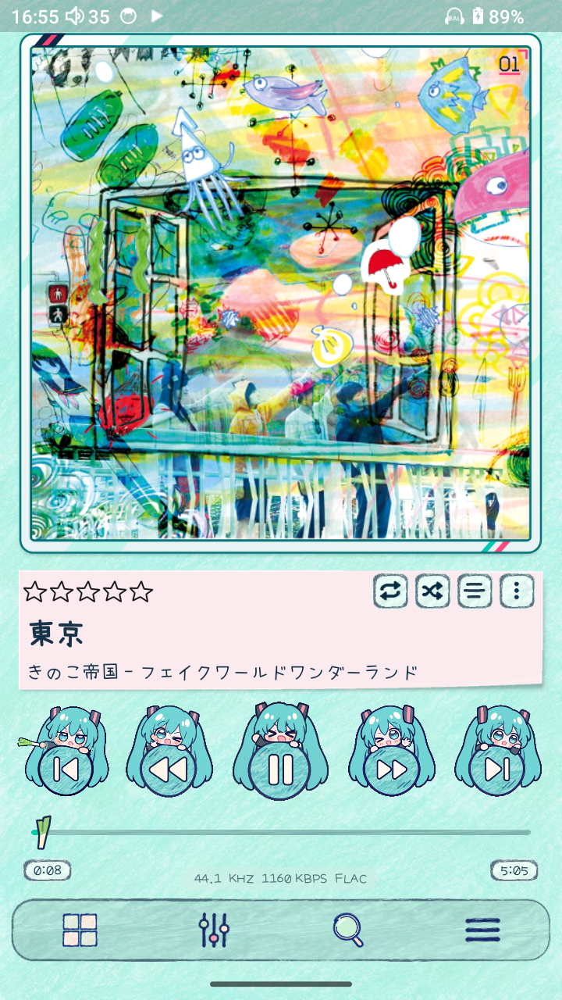
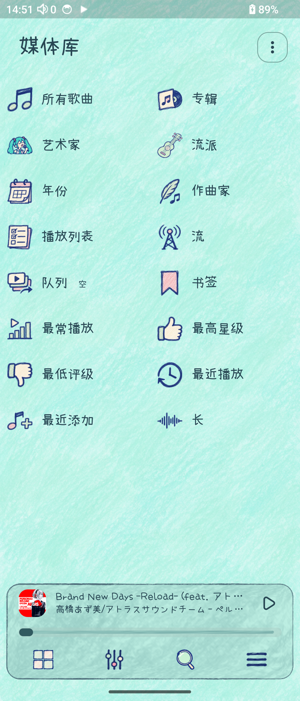
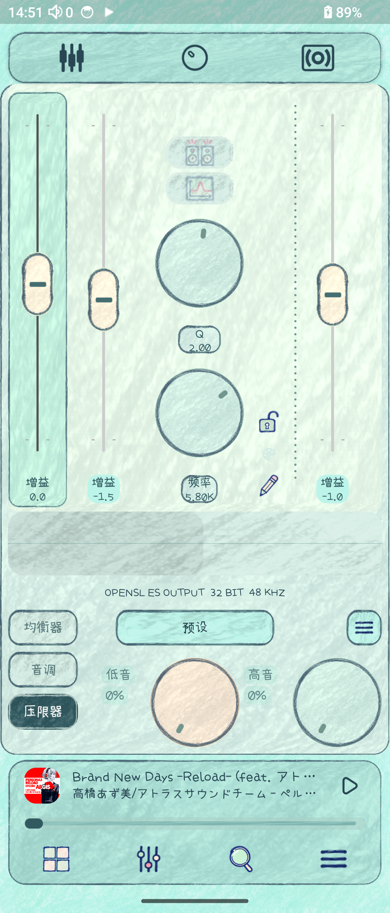
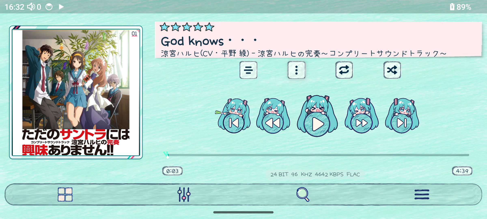

# 手描きミク · Hand-drawn Miku

[简体中文](README.md) · [English](README.en.md) · [日本語](README.ja.md) · [한국어](README.ko.md)

Android 版 Poweramp 向けの無料・非公式スキンです。ミント色の手描き風の画面に、端が少し浮いた紙の曲名ラベルと、初音ミクを描いた5つの再生ボタンを配置しました。

## M500 実機動画

M500 で「手描きミク」1.16.72 を操作する様子を収録しました。全編は1分13秒で、0:51から横画面に切り替わります。

https://github.com/user-attachments/assets/50e85f08-bc37-40c7-8f55-6b9f102600f7

## 画面サンプル

縦画面のプレーヤー、ライブラリ、イコライザーです。画像は開発中に撮影したもので、インストールしたバージョンとは表示が多少異なる場合があります。

  

## インストール方法

1. Android 端末に Poweramp 音楽プレーヤーをインストールします。
2. このリポジトリの **Releases** を開き、**v1.00 → Assets** から **Miku-Handdrawn-1.00.apk** をダウンロードしてインストールします。
3. Poweramp の **設定 → 外観（Look and Feel）→ スキン（Skin）** で **初音ミクの手描きスキン** を選びます。

**スキンの署名認証**　このスキンの署名は、現時点では Poweramp の認証を受けていません。署名を確認するバージョンでは、初めて選択してから約48時間で未認証スキンの選択が自動的に解除されます。 [Poweramp 公式ドキュメント](https://github.com/maxmpz/powerampapi/blob/master/poweramp_skin_sample/readme.md#skin-verification)

## 制作・クレジット

- スキンのデザイン・実装は M500 MIKU が担当しました。無料で、広告や有料機能はありません。
- 「初音ミク」はクリプトン・フューチャー・メディア株式会社のキャラクターです。 [ピアプロのキャラクター利用ガイドライン](https://piapro.jp/license/character_guideline)
- 再生ボタンのキャラクター原画は、みらつ／밋다다 さん（@miratsu169）の作品です。原画をもとに AI の補助を使って模写し、ボタンに合わせてポーズを少し調整しました。早送り用の絵は、巻き戻し用の原画を左右反転して調整したものです。 [作者の X](https://x.com/miratsu169)
- 画像内のジャケットや楽曲情報に関する権利は、それぞれの権利者に帰属します。

**権利者の方へ**　ボタンのイラストを含むスキンの公開について、原画の作者に使用許諾をお願いし、現在お返事をお待ちしています。掲載内容の削除や訂正をご希望の権利者の方は、このリポジトリの Issues から管理者にご連絡ください。
